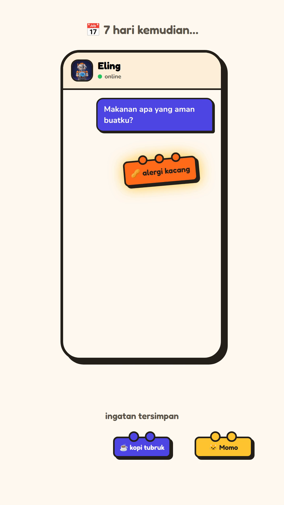

<p align="center">
  
</p>

<h1 align="center">Eling 🧱 — the bot that never forgets</h1>

<p align="center">
  <a href="https://www.deepsurge.xyz/hackathons/c0141a4a-21be-4009-bc63-7c168608c849"></a>
  
  
  
  
  
</p>

**Eling** (*ingat* = "remember" in Javanese) is a Telegram AI companion with real long-term memory.
Tell it anything — your peanut allergy, your cat's name, your deadlines — and it remembers
**across sessions and across devices**, because every memory lives in decentralized
[Walrus Memory](https://docs.walrus.site/), not on the bot's server.

Built for **Walrus Session 8: Chatbots That Remember**.

<p align="center">
💬 <b>Try it live:</b> <a href="https://t.me/ElingWalz_bot">@ElingWalz_bot</a> on Telegram
&nbsp;·&nbsp;
🌐 <b>Landing page:</b> <a href="https://eling-landing-nxrskyaas-projects.vercel.app/">eling-landing-nxrskyaas-projects.vercel.app</a>
&nbsp;·&nbsp;
🎬 <b>Demo video:</b> <a href="eling-video/out/eling-demo-portrait.mp4">eling-demo-portrait.mp4</a> (45s, portrait)
</p>

## The money moment

<p align="center">
  
</p>

> Day 1 — you: *"Eling, remember: I'm allergic to peanuts."*
> Seven days later — you: *"What food is safe for me?"*
> Eling: *"No peanuts! You're allergic — I still remember from last week 😉"*

## How it works

```
Telegram user ──/start /memories /pair /language + free chat──▶ bot.py
                                                              │
                              ┌───────────────────────────────┘
                              ▼
                           brain.py  (ElingBrain)
                              ├── recall()   → Walrus Memory, namespace eling:u<telegram_id>
                              │                (per-user isolation, distance-filtered)
                              ├── generate() → Gemini, with memories as context
                              │                (automatic model fallback chain)
                              └── remember() → Walrus Memory (deduped, fire-and-forget)
```

**Memory pipeline details:**
- **Recall-before-reply** — every message first queries Walrus Memory for relevant facts about
  *that* user, then Gemini answers with those facts as context.
- **Dedup on write** — `remember()` is append-only, so the brain compares embedding distance
  against existing memories and skips near-duplicates (same fact reworded ≠ new memory).
- **Distance filtering on read** — `recall()` has no relevance cutoff, so results are filtered
  by embedding distance; only genuinely relevant memories reach the prompt.
- **`*AndWait` writes** — indexing can lag seconds, so memories are written synchronously to be
  recallable immediately.
- **Gemini fallback chain** — if the primary model returns 503/429/404, the brain automatically
  fails over through `gemini-3.5-flash → gemini-3.5-flash-lite → gemini-flash-lite-latest`.
- **Cross-device** — `/pair` generates a one-time 6-digit code; the web widget (`webapp.py`)
  joins the same Walrus namespace, so memories follow you to any device.
- **Trilingual** — `/start` offers 🇮🇩 Bahasa Indonesia, 🇬🇧 English, 🇨🇳 中文; UI, commands,
  and the system prompt all follow the user's choice.

## Run it yourself

```bash
git clone https://github.com/nxrskyaa/eling.git && cd eling
python3 -m venv .venv && source .venv/bin/activate
pip install -r requirements.txt
cp .env.example .env   # fill in TELEGRAM_TOKEN, GEMINI_API_KEY, MEMWAL_*
python bot.py
```

No keys? The bot still runs: without `MEMWAL_PRIVATE_KEY` it uses an in-memory mock
(data lost on restart); without `GEMINI_API_KEY` it replies that it's not configured.

Tests (offline, no network): `python -m pytest tests/ -q`

## Commands

| Command | What it does |
|---|---|
| `/start` | Intro + language picker (🇮🇩/🇬🇧/🇨🇳) |
| `/memories` | List everything Eling remembers about you |
| `/pair` | One-time 6-digit code to link the web widget |
| `/language` | Change language anytime |
| `/bantuan` | Help (also `/help`) |

Anything else you type is chatted about normally — and important facts are saved automatically.

## Project structure

```
eling/
├── bot.py            # Telegram wiring (python-telegram-bot, asyncio)
├── brain.py          # ElingBrain: recall → Gemini → deduped remember
├── config.py         # settings + proxy sanitization
├── i18n.py           # UI strings (id/en/zh)
├── langstore.py      # per-user language preferences
├── webapp.py + web/  # paired web widget (6-digit /pair codes)
├── landing/          # public landing page (deployed on Vercel)
├── eling-video/      # 45s demo video (Remotion source + MP4)
├── brand/            # avatar artwork
├── tests/            # pytest suite (offline)
└── systemd/          # production service unit
```

## Submission

- 📝 Article: *coming soon* (Medium/Inkray)
- 𝕏 Post: *coming soon* (`@WalrusProtocol` + `#WalrusMemory`)
- 🎬 Demo video script: [DEMO_VIDEO_SCRIPT.md](DEMO_VIDEO_SCRIPT.md)

## License

MIT — do whatever you want with it, just remember us. 🧱
